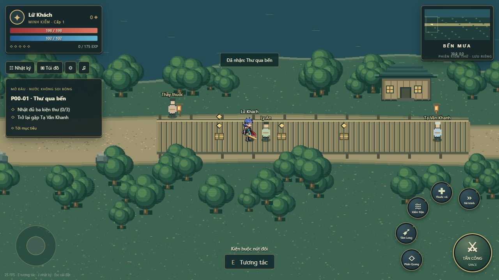

# Muse — thiết kế và gói sản xuất map Bến Mưa

Ngày giao 2026-10-30, Asia/Tokyo. Theo yêu cầu chủ dự án: nhận **toàn bộ gói Bến Mưa**, đi qua các milestone có review; sau mỗi PR tiếp tục phần độc lập, không đợi giao lại một việc nhỏ. Liên kết issue Muse #1. Codex phụ trách tích hợp client và review; Muse phụ trách hình ảnh, tilemap/layer, source và Unity proof khi có máy phù hợp.

## 1. Bộ mẫu có thể mở trực tiếp từ GitHub

1. [Gameplay Bến Mưa đã chạy](Art_Concept_References/ben_mua_playtest_v1/01_gameplay_route_reference.jpg): bố cục HUD, tỷ lệ hero, các điểm bến và tuyến khởi đầu. Đây là screenshot bản chơi thử Canvas, **không phải art final hoặc screenshot Unity**.
2. [Board môi trường v1](Art_Concept_References/v1/02_ben_mua_thang_long_environment.png): **nửa bên trái** là mood Bến Mưa, nước xanh mưa, gỗ bạc, lau/sen, đèn vàng. Nửa phải là Thăng Long, không đem quảng trường/khán đài vào Bến Mưa. Board còn quá nhiều texture và có phối cảnh xiên; chỉ lấy mood/vật liệu, dựng lại top-down và giản lược.
3. [Chuẩn pixel](Pixel_Art_Production_Standard_vi.md), [top-down XY](Top_Down_Gameplay_World_Spec_vi.md), [Atlas §3](Map_Production_Atlas_vi.md), [Quest Spec phần mở đầu](Quest_and_Narrative_Production_Spec_vi.md).
4. Các file `Tools/PlayablePreview/renderer.mjs`, `engine.mjs`, `content.json` cho biết bản thử đang đặt gì. Muse clone repo để xem source; localhost8090 của PC chủ dự án không truy cập được từ VM. Browser renderer là blockout thay tạm, không phải yêu cầu chép nguyên kiểu cây tròn/NPC hình hộp/quái procedural.

## 2. Cách nhìn và cảm giác cần đạt

Làng bến nhỏ trong mưa, có người sinh sống; đi từ an toàn/ấm đèn sang đầm bất an, rồi thoáng sáng ở bờ Đông. Đường đọc được ngay, hero/quest marker/telegraph nổi trên nền. Đất ít noise; cây có3mảng tán lớn và silhouette riêng, nhà gọn mái/ngói/gỗ; tránh hạt sáng trắng rải khắp map.

Camera orthographic top-down chếch thấy mái và thân, **không isometric/side-scroll**, di chuyển8hướng XY. +Y là Bắc trên mặt đất; y=-1/-3 là phía Nam, không độ sâu hoặc độ cao. P1 dùng một floor OVERWORLD; cầu không tự tạo tầng chồng đường chưa có contract.

20PPU, tile16×16px =0,8WU; hero48×64px, chân giữa. Không gán mỗi tile16px thành1WU hoặc kéo hero cho hợp mái. Point/no mipmap/lossless, source native và preview nearest. Material3tone+1highlight; nước4frame, bóng bậc màu, không blur/bloom/gradient mượt. Giữ vùng nhìn combat32×18WU và preview rộng48×27WU riêng để xem độ đọc; ảnh browser rộng không đổi camera fairness production.

## 3. Macro layout và tuyến chơi

MapID `MAP_BEN_MUA`. Bounds hiện hành X0..360, Y-12..72 theo `map_bounds.json`; đây là envelope, chưa có nghĩa toàn vùng đi được. Bản browser chỉ dùng hành lang Y-11..9 để chơi nhanh; **không thu toàn map production thành dải hành lang đó**. Đề xuất nhánh Bắc–Nam, vòng bờ/đảo nhỏ và landmark trên mặt bằng rộng, giữ tuyến chính thông suốt.

| Vùng X (WU) | Thiết kế cần dựng | Chức năng/đọc đường |
|---|---|---|
| 0–28 | Bến Gỗ, đường đất vào, bụi thấp,2đá, dấu cổng bến xa | Spawn18; safe arrival/respawn24, lối ra không bị decor bịt |
| 28–68 | Bến gỗ chính, kho mái thấp neo60, cọc/dây/thùng/đèn | Ly An42, ba kiện36/44/52, Tạ64; tương tác nhìn thấy ngay |
| 68–110 | Đường bờ cong, lối vòng cây/đá, cầu92–108 | Hướng dẫn chiến đấu, checkpoint80; main path không thắt cổ chai |
| 110–154 | Đầm nông, lau/sen, bệ gỗ122–138, nhánh cứu dân | Gợn nước122/132/142, rễ và dân; đường tránh sóng rõ |
| 154–202 | Đầm Chuông, cột chuông neo178, bờ đá và4cọc chuông | Boss ring178, diameter22; hai đường thoát và mặt sàn ít noise |
| 202–255 | Cầu202–228, bè, đèn210/222/246, nhà239/252 | Chuyển nhịp sau boss, nhánh ngắm cảnh không chặn tuyến chính |
| 255–315 | Ruộng bờ, cụm cây/đá, cỏ và nhánh thu thập | Kẻ Rình Bờ270, tinh anh303; cảnh vật thoáng hơn đầm |
| 315–360 | Xe326, biển333/357, đèn340/354, cổng348 | Người giữ thuyền343, điểm kết tuyến/route selector |

Main path rộng tối thiểu8WU theo top-down spec; nhánh có điểm quay đầu, không bít NPC. Giữ foot collision tách tán cây/mái, fade foreground khi che hero; nước sâu có blocked polygon rõ, nước nông/decor không tự thành chỗ chết. Chia render/authoring thành6dải64WU để làm việc; dải cuối chỉ tới360. Đây là cách chia sản xuất, không tự thêm portal/loading screen giữa các dải. Có thể subdivide theo Y khi cần, không đổi coordinate origin.

## 4. Anchor nhiệm vụ và NPC phải đối chiếu

| Nhóm | ID/điểm theo nguồn (WU) | Yêu cầu đồ họa |
|---|---|---|
| NPC chính | NPC_LYAN(42,0), NPC_TA_VAN_KHANH(64,0) | Marker/foot readable, khoảng tương tác không bị lan can/tường chắn |
| Dịch vụ/điểm cuối | NPC_MEDIC_BEN(30,0), NPC_FISHER_01(112,0), NPC_CLASS_TRIAL(188,0), NPC_BOAT_KEEPER(343,0) | Class trial chỉ xuất hiện sau boss theo state; không nhân bản NPC cho từng quest |
| Kiện thư | OBJ_BM_PACKAGE_01/02/03=(36,0)/(44,0)/(52,0) |3silhouette/dấu buộc khác nhau; available/collected theo từng nhân vật, không biến mất cho người khác |
| Gợn nước | OBJ_BM_WATER_RIPPLE_01/02/03=(122,-1)/(132,-1)/(142,-1) | Vòng gợn4frame, dấu điều tra; không nhấp đúng một pixel mới nhận được |
| Rễ nhiệm vụ | (126,0)/(138,0)/(151,0) theo Atlas | Tách gốc sống/phá và quái, tránh lẫn cỏ decor |
| Cứu dân | NPC_BM_RESCUE_01=(135,0), NPC_BM_RESCUE_02=(148,0) | Bị giữ/được cứu có state; giữ anchor/checkpoint, không vẽ xác |
| Hộ tống | Ly An qua80 và120; waveA76/80/84, waveB116/120/124 | Lối đủ rộng cho NPC+hero+3quái; tắt spawn chồng wave bằng runtime state, không vẽ cả hai lớp mob luôn |
| Boss/mảnhấn | BOSS_MANG_COT(178,0), OBJ_BM_SEAL(178,0) sau death | Mảnhấn khác loot, chỉ sáng khi objective unlocked; không có mảnh từ đầu map |
| Hồi/cổng | SP_BM/TP_BM_HUB(24,0), TP_BM_DAM_CHUONG(150,0), cổng Đông(348,0) | Có khoảng arrival2WU+, state locked/open; cùng anchor348 dùng route selector, không2cổng tranh trigger |

Các XY trên là original anchors chờ top-down review. **Không âm thầm áp tọa độ NPC lệch trong screenshot browser lên manifest** (ví dụ healer được vẽ lệch để thử nhìn). Nếu cần dời vì nav/safe zone, giao sidecar originalRecordId/originalXY/newXY/floor/reason, chờ Codex/Qoder review migration.

Xung đột nguồn cần ghi rõ: fisher112,0 gần spawn116,0 hơn quy tắc safe-NPC18WU. Đề xuất bố trí nhánh an toàn/di chuyển anchor bằng migration candidate hoặc tách vùng encounter theo state, không vừa giữ tọa độ vừa tự báo đã đạt safe-distance. Vẫn tiếp tục tile/prop/art phần độc lập trong lúc chờ review.

Quái nhóm:84 có3Cá Linh;116 có4Cá Linh;143 có3Rễ Nước;160 có2Cá Linh+1Rễ; boss178×1;270 có3Kẻ Rình Bờ;303 có1tinh anh+2thường. Dùng full `World_Spawn_Gathering_Manifest_vi.csv` filter MAP_BEN_MUA để lấy node/ID/số lượng/respawn/patrol; không lấy số quái đang hiển thị trong screenshot hoặc local fixture làm toàn bộ spawn list.

## 5. Arena và weather không được mất thông tin gameplay

Mãng Cốt: quét cone120°/8WU báo0,9s; trồi circle radius4WU tại điểm target khóa báo1,2s; bọt annulus3..7WU báo1s. Phần nền không có vòng đỏ vẽ chết trong texture: telegraph là layer riêng, hiện/tắt do event. Pha3 có2bệ an toàn ở ngoài7WU, trong arena và nối được bằng nav; vị trí mới là candidate trước review. Không dùng chiều dài thân rắn làm hitbox hoặc thu nhỏ danger shape cho vừa khung ảnh.

Layer tách: ground→shore/water→path/bridge→lowprops→actor sockets→canopy/roof→weather; collision/nav/interaction overlay debug riêng. Mưa nhẹ/vừa và LowFX; wet tiles tối nhẹ, không phủ màn xám làm chìm hero, không hạt mưa che dấu hỏi. Animation nước/lau/đèn nhẹ, tắt được; telegraph không tắt theo LowFX.

## 6. Bàn giao toàn gói theo milestone

1. **BM-A layout:** macro overview toàn360WU,8vùng, tuyến5quest, nhánh Bắc–Nam, overlay NPC/node/mob/portal, footprint/nav candidate và migration list; không auto đánh REVIEWED. Trong lúc layout chờ review, làm palette/tile kit.
2. **BM-B native kit + dải đầu0–64:** ground/shore/wood/water/roof/props, source có layer, sheet16px; cảnh thực có hero48×64+LyAn+3kiện để đo tỷ lệ. Giao preview native640×360, wide960×540 và upscale720p/1080p.
3. **BM-C hoàn tuyến:** dải64–360, arena, nhánh cứu dân/hộ tống/portal, phiên bản collision debug và clean art; bảo đảm nối seam, không có atlas bleed/pivot sai. Hoàn các nhóm quái/node liên quan theo hàng đợi art đã nhận.
4. **BM-D tích hợp:** candidate tile/prop manifest theo schema hiện hành, `.meta`/PPU/point/lossless, source và palette; Unity import log/video exact SHA nếu có Editor. Test spawn→3kiện→gợn/cá→cứu dân→80/120→boss/mảnhấn→188→348, không cheat teleport để chứng minh nav.

Branch `muse/ben-mua-map-production` hoặc tiếp branch Muse phù hợp có ghi checkpoint. Asset/source: `Art_Source/Maps/BenMua/`, `Client/Assets/Art/Environment/BenMua/`, `Client/Assets/Tilemaps/`, `Client/Assets/ArtManifests/`. Sidecar layout candidate giữ trong ArtManifests khi chưa có runtime/schema được duyệt; không thêm field lạ vào closed delivery schema. Không sửa server/contracts/browserengine hoặc toàn349placement để hợp ảnh.

PR liên kết #1, có ảnh trực tiếp, asset list/state/provenance, source/native/export, file map/key liên quan và exact SHA. Dùng Git LFS, không gửi đường dẫn máy ảo hoặc localhost để chủ dự án tự đoán. Phản hồi nhận cả gói/branch/milestone; sau PR tiếp phần độc lập của gói, không dừng cả gói để đợi review một ảnh. Chưa có engine proof thì ghi unverified, art approval không thay topology/device QA.
